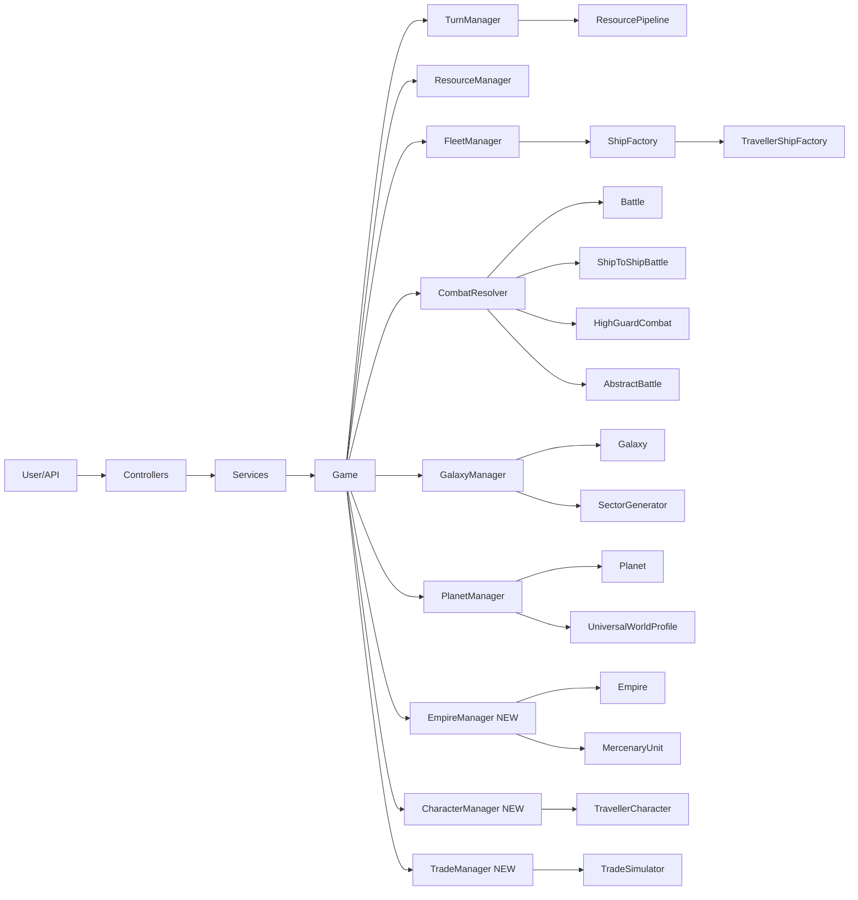

# Current Systems Overview

## DoraMCU 4X Game System

**Core architecture:** `Game` coordinator → 7 managers → entities
- **Game.java** (1129 lines): central coordinator holding all collections (players, planets, fleets, ships, galaxies, battles, empires)
- **Managers:** TurnManager, ResourceManager, FleetManager, CombatResolver, GalaxyManager, PlanetManager, FacilityConstructionManager
- **Ship.java** (626 lines): component-based warship with ShipType (Frigate–Mothership), weapons, shields, hull, MDrive/JDrive
- **Fleet.java** (858 lines): group of ships with combat simulation
- **Battle.java** (698 lines): structured battle lifecycle with round-by-round combat, defender bonuses, reinforcements
- **Planet.java** (658 lines): 4X stats (resources, population, facilities, ownership), 3D hex geometry, defense
- **Galaxy.java** (1754 lines): sector/subsector/solar system hierarchy with celestial bodies and hyperlanes
- **Player.java** (727 lines): identity (email, PIN, government, ethos) + game state (planets, fleets, resources)
- **ResourcePipelineManager**: mining → processing → assembly pipeline for ship construction modules
- **Empire.java**: navy, army, facilities per empire

## Traveller RPG System (hex.traveller package, 85+ files)

- **Character creation:** TravellerCharacter, AbilityScore (7 stats), Career (8 careers), Skill (24 skills)
- **Ship design:** ShipDesign (tonnage-based modular), JumpDrive, FusionDrive, PowerPlant, LifeSupport, ShipComputer
- **Ship combat:** ShipToShipBattle (hit locations, damage in megatons), HighGuardShipCombat (advanced)
- **Naval:** NavalBattle, NavalFleet, NavalSquadron, NavalOfficer
- **Worlds:** UniversalWorldProfile (UWP), TradeCode, SectorGenerator, Hyperlane
- **Trade:** Commodity, MarketConditions, TradeMission, TradeSimulator
- **Mercenary:** MercenaryCareer, MercenaryUnit, MercenaryTicket, AbstractBattle
- **Travel:** JumpTravel, ManeuverPlan, RoutePlanner, PlanetApproach
- **Bridge:** TravellerShipFactory (converts ShipDesign → hex Ship), TravellerFleetBuilder (converts designs → Fleet)

## Key Gap
The two systems exist side-by-side but are loosely connected. The Traveller system provides rich RPG mechanics (characters, careers, skills, world generation, trade) but no empire management, turn-based resource production, or large-scale fleet combat. The DoraMCU system provides empire-scale 4X gameplay but no character-level RPG mechanics, no tonnage-based ship design, and no world generation or trade.

# Integration Plan

### Strategy: Traveller as the Base Layer, DoraMCU as the Empire Layer

The Traveller system will become the **foundation** for all game mechanics. The DoraMCU 4X systems will be **integrated on top** as empire-scale management layers. All existing DoraMCU game functions will be preserved.

### Architecture

### Layer 1: Character Integration (New)
- **TravellerCharacter** becomes the player's avatar within the DoraMCU empire
- Each `Player` gains an optional `TravellerCharacter` as their commander
- Character abilities, skills, and career provide **bonuses** to empire operations:
  - **Soldier/Mercenary** career → ground combat bonuses for ArmyUnit
  - **Pilot** career → ship evasion/speed bonuses
  - **Gunner** career → ship damage bonuses
  - **Explorer** career → planet survey bonuses
  - **Merchant** career → trade profit bonuses
  - **Noble** career → diplomacy/government bonuses
- New `CharacterManager` in `hex.manager` package handles character creation and career progression

### Layer 2: Ship Design Integration (Enhanced Bridge)
- **TravellerShipFactory** already converts ShipDesign → hex Ship. Enhance it:
  - Support **HighGuardShipDesign** → hex Ship with armor, energy points, advanced weapons
  - Map Traveller hit locations to hex HullModule damage
  - Preserve Traveller design metadata (tonnage, crew, cost) on converted ships
- **ShipDesign** becomes the primary way to create new ship types in DoraMCU
- **FleetManager** delegates to TravellerShipFactory when building from designs
- Keep existing `ShipType`-based ship creation for simplicity

### Layer 3: Combat Integration (Unified)
- **Space combat:** `Battle` (hex) remains for fleet-vs-fleet combat. `ShipToShipBattle` (Traveller) used for individual ship duels and High Guard naval battles
- **Ground combat:** `AbstractBattle` (Mercenary) used for planetary invasions and army combat
- **CombatResolver** delegates to the appropriate combat system based on context:
  - Fleet vs Fleet → hex `Battle`
  - ShipDesign vs ShipDesign → `ShipToShipBattle`
  - HighGuardShipDesign vs HighGuardShipDesign → `HighGuardShipCombat`
  - ArmyUnit vs ArmyUnit → `AbstractBattle`

### Layer 4: World Generation Integration (Enhanced)
- **SectorGenerator** (Traveller) generates `TravellerWorld` with UWP profiles
- **GalaxyGenerator** (hex) enhanced to use SectorGenerator for world properties
- **Planet** (hex) gains UWP fields: atmosphere, gravity, population level, starport class, government, law level
- **TradeCode** applied to planets for economic modifiers
- **Hyperlane** generation shared between systems

### Layer 5: Trade and Economy Integration (New)
- **TradeSimulator** (Traveller) provides commodity trading between worlds
- **ResourcePipelineManager** (hex) handles empire-scale resource production
- New `TradeManager` coordinates:
  - Commodity prices based on world trade codes and supply/demand
  - Trade missions using Traveller ships
  - Resource extraction from planets feeds into pipeline
- **Commodity** prices affect ship construction costs and empire income

### Layer 6: Empire and Mercenary Integration (Enhanced)
- **Empire** (hex) gains Mercenary army organization
- **MercenaryUnit** used for planetary defense and invasion
- **MercenaryTicket** provides income for mercenary-focused empires
- **EmpireArmy** integrates with Mercenary unit hierarchy

### What Stays Unchanged
- `Game` coordinator pattern and manager delegation
- `Player` identity, government, ethos system
- `ResourcePipelineManager` for mining/processing/assembly
- `Battle` for fleet-vs-fleet hex combat
- `Galaxy` hierarchy (sectors, subsectors, solar systems)
- `Ship` component-based combat model
- `Planet` 4X statistics (population, facilities, ownership)
- All existing API controllers and DTOs

### What Changes
- `Player` gains optional `TravellerCharacter` commander
- `Planet` gains UWP fields and trade codes
- `Ship` can be created from `ShipDesign` (Traveller) or `ShipType` (hex)
- `CombatResolver` delegates to Traveller combat systems based on context
- `GalaxyGenerator` uses `SectorGenerator` for world properties
- New managers: `CharacterManager`, `TradeManager`, `EmpireManager`
- New bridge: `HighGuardShipFactory` for advanced ship conversion

# Delivery Plan

### Phase 1: Character Integration
- Add `TravellerCharacter` field to `Player` with commander bonuses
- Create `CharacterManager` for character creation and career progression
- Implement ability/skill bonuses to empire operations (combat, trade, exploration)

### Phase 2: Enhanced Ship Design Bridge
- Enhance `TravellerShipFactory` to support `HighGuardShipDesign`
- Create `HighGuardShipFactory` for advanced ship conversion (armor, energy, meson guns)
- Integrate `ShipDesign` into `FleetManager` for design-based fleet creation
- Preserve design metadata on converted ships

### Phase 3: Unified Combat Resolution
- Enhance `CombatResolver` to delegate to Traveller combat systems
- Fleet vs Fleet → hex `Battle` (unchanged)
- ShipDesign vs ShipDesign → `ShipToShipBattle`
- HighGuard vs HighGuard → `HighGuardShipCombat`
- Army vs Army → `AbstractBattle` (Mercenary)
- Add ground combat support for planetary invasions

### Phase 4: World Generation and Trade
- Enhance `Planet` with UWP fields and trade codes
- Integrate `SectorGenerator` into `GalaxyGenerator`
- Create `TradeManager` for commodity trading between worlds
- Connect `TradeSimulator` with `ResourcePipelineManager`

### Phase 5: Empire and Mercenary Integration
- Integrate `MercenaryUnit` into `EmpireArmy`
- Add `MercenaryTicket` income system
- Connect mercenary career to empire ground forces
- End-to-end integration tests

# Delivery Steps

### ✓ Step 1: Character Integration - Player Commander System
Add TravellerCharacter as optional commander to each Player, with ability and skill bonuses affecting empire operations.
- Add `TravellerCharacter commander` field to `Player.java` with getter/setter
- Create `CharacterManager.java` in `hex.manager` package for character creation, career terms, and skill acquisition
- Add `Game.setCharacterManager()` and character accessor methods
- Implement bonus system: Soldier/Mercenary → army combat DM, Pilot → ship evasion%, Gunner → ship damage%, Explorer → survey speed, Merchant → trade profit%, Noble → government bonuses
- Update `Player.toString()` to include commander info
- Add tests for character creation, career progression, and bonus application

### ✓ Step 2: Enhanced Ship Design Bridge - High Guard Support
Enhance TravellerShipFactory and add HighGuardShipFactory to convert all Traveller ship designs to hex Ships.
- Enhance `TravellerShipFactory.java`: add support for HighGuard armor types, energy points, and advanced weapons (meson guns, fusion guns, sandcasters)
- Create `HighGuardShipFactory.java` in `hex.traveller` package: converts `HighGuardShipDesign` to hex `Ship` with armor HP, thrust-based speed, and turret weapons
- Update `FleetManager.java`: add `createFleetFromDesigns(List<ShipDesign>)` method that uses TravellerShipFactory
- Add design metadata preservation: store tonnage, crew, cost as Ship properties or attached metadata
- Create `TravellerFleetBuilder` integration with `Game.addFleet()` workflow
- Add tests for High Guard ship conversion and fleet creation from designs

### ✓ Step 3: Unified Combat Resolution - Multi-System Delegation
Enhance CombatResolver to delegate to the appropriate combat system based on entity types.
- Modify `CombatResolver.java`: add overloaded `resolveCombat()` methods that detect combatant types
- Fleet vs Fleet → existing hex `Battle.fightToCompletion()` (no change)
- ShipDesign vs ShipDesign → `ShipToShipBattle` coordination
- HighGuardShipDesign vs HighGuardShipDesign → `HighGuardShipCombat`
- ArmyUnit vs ArmyUnit or MercenaryUnit vs MercenaryUnit → `AbstractBattle` (Mercenary)
- Add `GroundBattleResolver.java` for planetary invasion scenarios using Mercenary units
- Update `Game.engageFleets()` to support design-based combat
- Add tests for each combat delegation path

### ✓ Step 4: World Generation - UWP and Trade Integration
Integrate Traveller world generation (UWP, trade codes) into DoraMCU planets and galaxy generation.
- Add UWP fields to `Planet.java`: atmosphere, gravity, population level, starport class, government type, law level (as enums or int fields)
- Add `Set<TradeCode>` to `Planet.java` with getter/setter
- Create `WorldProfileAdapter.java` in `hex.traveller`: converts `UniversalWorldProfile` to `Planet` properties **DONE**
- Enhance `GalaxyGenerator.java`: use `SectorGenerator` to generate world UWP and trade codes during planet creation **DONE**
- Enhance `CelestialBodyGenerator.java`: added `generatePlanetWithUWP()` with trade code derivation **DONE**
- Enhance `SolarSystemGenerator.java`: UWP flag for planet generation **DONE**
- Create `TradeManager.java` in `hex.manager`: coordinates `TradeSimulator`, `Commodity` pricing, and trade missions **DONE**
- Connect `TradeManager` with `ResourcePipelineManager`: commodity extraction feeds pipeline, pipeline output affects trade supply **DONE**
- Add tests for UWP generation, trade code application, and trade simulation

### ✓ Step 5: Empire and Mercenary Integration - Ground Forces
Integrate Mercenary army organization into Empire ground forces and add mercenary ticket income.
- Enhance `EmpireArmy.java`: add `List<MercenaryUnit>` for organized ground forces
- Add `MercenaryUnit` creation methods to `EmpireArmy`: createFireTeam(), createPlatoon(), createCompany(), etc.
- Create `MercenaryIncomeManager.java`: handles `MercenaryTicket` contracts, profit calculation, and empire income **DONE**
- Integrate `MercenaryIncomeManager` with `TurnManager`: process ticket income during end-of-turn **DONE**
- Create `GroundBattleResolver.java`: planetary invasion scenarios using AbstractBattle **DONE**
- Add mercenary career bonuses: MercenaryCareer rank → unit morale/equipment bonuses **DONE**
- Update `Empire.java`: add ground force strength calculation and mercenary income tracking **DONE**
- Add end-to-end integration test: create empire → generate mercenary units → run ticket → verify income