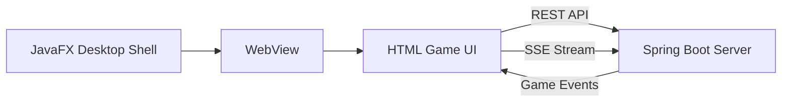

# Desktop Client UI Plan

## Overview
Build a **JavaFX WebView desktop client** that hosts the full 4X space strategy game UI using vanilla HTML/CSS/JS, communicating with the Spring Boot game server via REST APIs and SSE for real-time updates.

## Architecture

## Delivery Steps

### ✓ Step 1: Create HTML Game UI Pages
Build all HTML/CSS/JS pages for the game UI as static resources served by Spring Boot.

**Files to create:**
- `src/main/resources/static/css/game.css` — Dark space-themed game styles
- `src/main/resources/static/js/game-api.js` — REST API client with JWT auth
- `src/main/resources/static/js/game-sse.js` — SSE event handler for real-time updates
- `src/main/resources/static/js/game-ui.js` — UI logic and event handlers
- `src/main/resources/static/game.html` — Main game page with all panels

**Game page sections:**
1. **Login panel** — Replace existing index.html login with game-themed version
2. **Session panel** — Create/join/list game sessions
3. **Empire panel** — Resources, planets, fleets overview
4. **Galaxy map panel** — Hex-based galaxy visualization using Canvas
5. **Fleet panel** — Fleet management, movement, combat
6. **Event log panel** — Real-time game events from SSE

### ✓ Step 2: Create JavaFX WebView Shell
Build the desktop client launcher that hosts the HTML game UI.

**Files to create:**
- `src/main/java/com/yisy/modules/doramcu/client/DesktopClient.java` — JavaFX application entry point
- `src/main/java/com/yisy/modules/doramcu/client/WebViewFactory.java` — WebView configuration and JavaScript bridge

**Key features:**
- JavaFX Stage with WebView loading the game HTML
- JavaScript-to-Java bridge for native OS operations (file dialogs, system tray)
- Window sizing and theming to match the game's dark space theme
- Server URL configuration (default localhost:8080)

### ✓ Step 3: Update build.gradle for JavaFX
Add JavaFX dependencies and configure the build for the desktop client.

**Changes:**
- Add `org.openjfx:javafx-controls` and `org.openjfx:javafx-webview` dependencies
- Configure `mainClass` for the desktop client launcher
- Add shadow JAR plugin for fat JAR creation with JavaFX modules

### ✓ Step 4: Replace index.html with Game UI
Update the existing login page to be the game entry point.

**Changes to `index.html`:**
- Replace "Device Management System" branding with "DoraMCU 4X Space Strategy"
- After login, redirect to game.html instead of admin.html
- Keep the authentication logic intact

### * Step 5: Verify the complete flow
Test the full desktop client experience.

**Verification:**
- Launch the desktop client and verify the JavaFX window opens
- Login with existing credentials
- Create a game session, join as another player
- Perform game actions (move fleet, build ship, advance turn)
- Verify real-time SSE updates appear in the event log

### ✓ Step 5: Verify the complete flow
